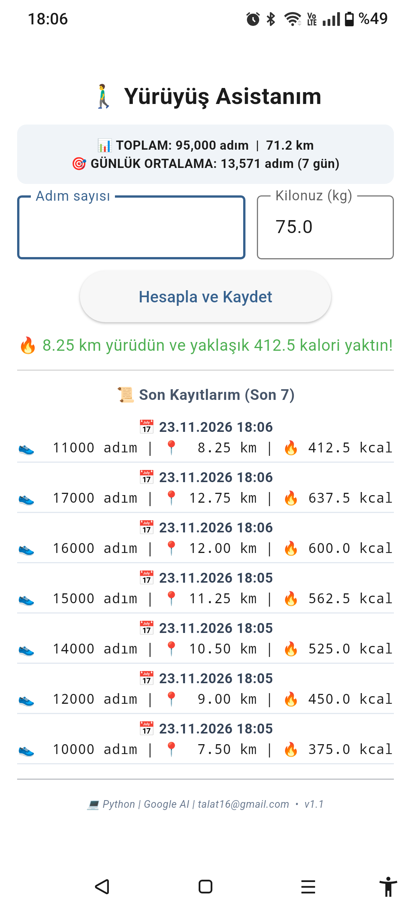

# 🚶‍♂️ Yürüyüş Asistanım (v1.1)

Python ile geliştirilmiş, internet bağlantısı gerektirmeden Android cihazlarda yerel hafıza ile çalışan kişisel yürüyüş, mesafe ve kalori takip uygulaması.

### ✨ Özellikler
- Günlük adım ve kilo bilgisine göre gerçekçi kalori ve mesafe (km) hesaplaması
- Cihaz hafızasında kalıcı veri saklama
- Genel toplam ve günlük ortalama istatistik kartı
- Son 7 günün milimetrik hizalı dökümü

### 📥 Kurulum
Sağ taraftaki **Sürümler (Releases)** bölümünden `app-release.apk` dosyasını indirip Android cihazınıza kurabilirsiniz.

  

